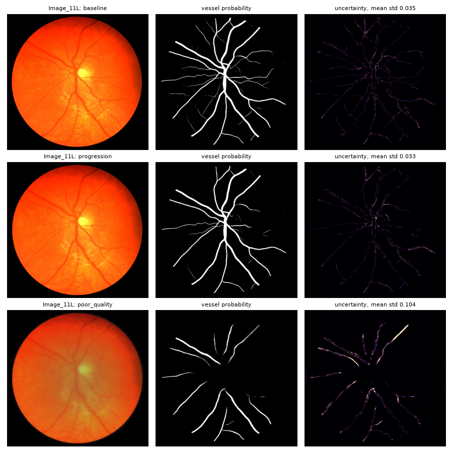
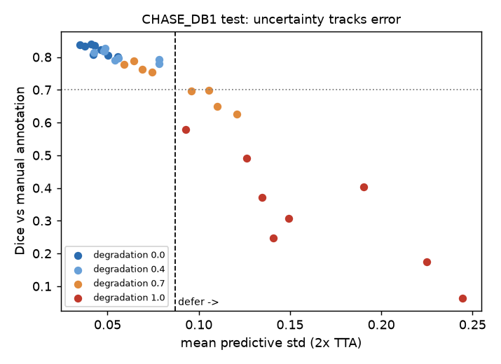

# Uncertainty-aware imaging agent for longitudinal retinal analysis

> **Work in progress.** This is an ongoing research project. All results below come from the rule-based planner; the LLM (Claude) planner is implemented but not yet evaluated.

A small agent that compares two fundus images of the same eye taken at different visits, measures how the vessels changed, and **decides by itself when its own measurement should not be trusted**. Every step is written to an audit trace.

Full write-up for non-specialists, including what went wrong and why this is not yet publishable: [docs/REPORT.md](docs/REPORT.md). File-by-file explanation of the code and every design choice: [docs/CODE_WALKTHROUGH.md](docs/CODE_WALKTHROUGH.md).

The question behind it: segmentation models are accurate on single, clean images, but in a longitudinal setting a bad acquisition or a bad alignment silently turns into a wrong "progression" call. An agent that calls tools, checks their uncertainty, retries, and defers to a clinician with a reason is easier to trust than a single number.



## How it works

```
             +-----------+   uncertainty too high?   +--------------------------+
 visit A --> |  segment  | ------------------------> | re-segment: 8x TTA +     | --still high--> DEFER (reason)
 visit B --> | (2x TTA)  |                           | 4 MC-dropout passes each |
             +-----------+                           +--------------------------+
                   | ok                                          | ok
                   v                                             v
             +-----------+   alignment NCC too low?
             | register  | ----------------------------------------------------> DEFER (reason)
             +-----------+
                   | ok
                   v
             +-----------+     +-----------+   change implausible (> 30%)?
             |  measure  | --> |  compare  | ------------------------------------> DEFER (reason)
             +-----------+     +-----------+
                                     | ok
                                     v
                    REPORT (change, and whether it exceeds the repeatability limit)
```

* **Tools** (`imaging_agent/tools.py`): `segment`, `register`, `measure`, `compare`. They return small JSON summaries; pixel arrays never go to the planner.
* **Uncertainty**: predictive std over test-time augmentations (dihedral group, up to 8) and MC-dropout passes (dropout before the segmentation head).
* **Change rule**: a change is real only if it exceeds a repeatability limit measured on stable scan pairs of calibration subjects. Without calibration, the fallback is "pessimistic and optimistic measurement bands do not overlap".
* **Plausibility check**: independent of the model. Catches confidently-wrong segmentations that uncertainty misses.
* **Planners** (`imaging_agent/agent.py`): Claude with tool use (if `ANTHROPIC_API_KEY` is set) or an offline rule planner. Both go through the same tools.
* **Guard**: `finish(decision="report")` is refused while any check is outside policy, whichever planner asks. An LLM cannot talk its way past an uncertain segmentation.
* **Audit trace**: every tool call, its arguments, its result, the policy thresholds and the planner are saved as JSON (`runs/chase/trace_*.json`).

## Results on real data (CHASE_DB1)

**Segmentation model.** U-Net with an ImageNet-pretrained ResNet-34 encoder (the setup from my A2I-26 study), trained on subjects 01-08, 3000 steps on 384 px crops, about 9 minutes on an RTX 3050 laptop GPU. On the test subjects (11-14, 8 images), inside the field of view:

| Dice / F1 | Sensitivity | Specificity | Accuracy |
| --- | --- | --- | --- |
| 0.820 | 0.850 | 0.977 | 0.965 |

These are not directly comparable with the A2I-26 numbers (different split, FOV handling and augmentation).

**1. Does uncertainty predict segmentation error?** Every calibration and test image was segmented clean and at three levels of simulated acquisition degradation (haze, blur, noise). The deferral threshold was fitted on the calibration subjects (09-10) only, then applied to the test subjects.



| On the 32 test segmentations | |
| --- | --- |
| Spearman correlation, uncertainty vs error (1 - Dice) | 0.96 |
| Segmentations with Dice < 0.70 caught | 12 / 12 |
| Usable segmentations wrongly deferred | 0 / 20 |
| Mean Dice, accepted vs deferred | 0.80 vs 0.44 |

**2. Agent on longitudinal pairs.** Each of the 8 test eyes gets 3 simulated follow-ups: *stable* (camera shift + exposure change), *vessel loss* (about half of the thin vessel segments erased from the real image, 6 to 10% of vessel area) and *vessel loss + poor acquisition*. The repeatability limit (2.9%) comes from stable pairs of the calibration subjects.

| Scenario | Correct decision | Notes |
| --- | --- | --- |
| Stable | 7 / 8 | one false change: -3.2% on 13R, just above the 2.9% limit |
| Vessel loss | 8 / 8 reported | mean absolute error vs ground truth: 1.2 percentage points |
| Vessel loss + poor acquisition | 8 / 8 deferred | 7 by uncertainty, 1 by the plausibility check |

**What failed, and what I changed.** Two findings came out of the first real-data run:

* The first comparison rule (pixel-wise uncertainty bands must not overlap) was far too conservative on real images: it detected only 1 of 8 vessel-loss cases (`runs/chase/results_band_rule.json`). I replaced it with a repeatability limit estimated on stable calibration pairs, which is how test-retest variability is usually handled clinically.
* On one hazy follow-up (14R) the model was **confidently wrong**: most vessels disappeared with low uncertainty, and the agent reported an 82% vessel loss. Uncertainty alone cannot catch this failure mode. I added a model-independent check: a change above 30% between two visits is treated as implausible and deferred. This check was added *after* seeing the test result, so it needs confirmation on new data.

## Synthetic sanity check

`scripts/train_synthetic.py` and `scripts/run_demo.py` run the same agent on procedurally generated fundus images with exact ground truth (small U-Net, no download). Stable: reported as within uncertainty. Vessel loss: -20.1% reported (truth about -19%). Hazy follow-up: retried with 8x TTA + MC dropout, then deferred.

## Run it

```bash
conda create -n imaging-agent python=3.11 -y && conda activate imaging-agent
pip install torch torchvision --index-url https://download.pytorch.org/whl/cu121
pip install -r requirements.txt

# real data (needs a Kaggle API token in ~/.kaggle/access_token)
kaggle datasets download ipythonx/retinal-vessel-segmentation --unzip -p data
python scripts/train_chase.py --steps 3000         # ~9 min on an RTX 3050
python scripts/evaluate_chase.py                   # calibration + agent evaluation, ~3 min
python scripts/figure_chase.py

# synthetic sanity check, no download
python scripts/train_synthetic.py --steps 1500
python scripts/run_demo.py --planner rules         # or --planner claude with ANTHROPIC_API_KEY

pytest -q                                          # tool and guard tests, no GPU needed
```

## Limitations

* The follow-up visits are simulated (vessel erasure, synthetic haze). Real longitudinal pairs are needed to know how the agent behaves on real disease progression and real acquisition failures.
* The degradations used to test uncertainty are synthetic too, so the 0.96 correlation is an upper bound on what to expect with real poor-quality images.
* 8 test eyes is small. The numbers need confidence intervals and a larger set before any claim.
* Registration is translation-only (phase correlation). Real follow-ups need rigid or deformable registration.
* Vessel density is a coarse biomarker. Calibre and tortuosity per vessel segment would be more clinically meaningful.

## Next steps

1. Cross-dataset test: train on CHASE_DB1, run the agent on DRIVE, STARE and HRF, where the domain shift is real rather than simulated.
2. Risk-coverage curves for the deferral policy, with confidence intervals.
3. Replace the hand-set rules with a learned deferral policy (rewarded for correct reports, penalized for wrong ones, with a cost per deferral).
4. Move from retinal vessels to lesions in longitudinal oncology imaging, where the same pattern applies to tumour-response assessment.

## Author

Mohamed Fares Slimani, PhD candidate, LIMOSE Laboratory, Universite M'Hamed Bougara de Boumerdes. Related work: *Advancing Retinal Vessel Segmentation: A Comparative Study of U-Net Variants and FR-UNet* (A2I-26, 2026).
