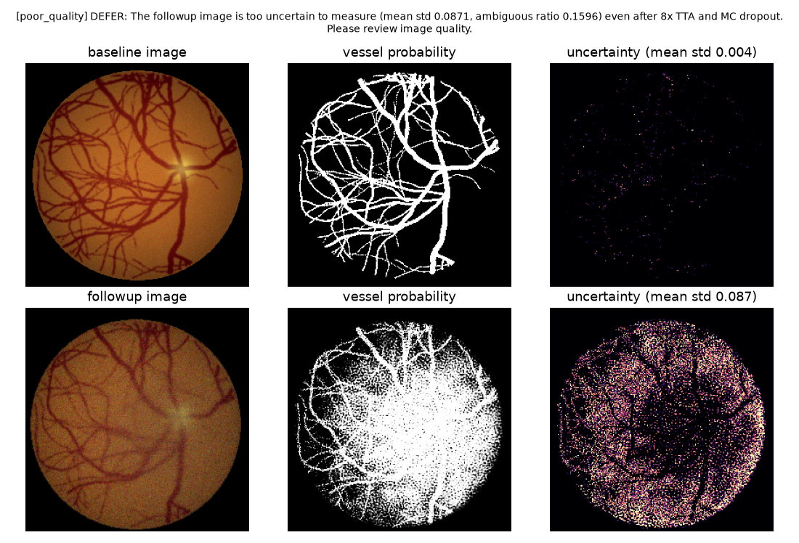

# Uncertainty-aware imaging agent for longitudinal retinal analysis

A small agent that compares two fundus images of the same eye taken at different visits, measures how the vessels changed, and **decides by itself when its own measurement should not be trusted**. Every step is written to an audit trace.

The question behind it: segmentation models are accurate on single, clean images, but in a longitudinal setting a bad acquisition or a bad alignment silently turns into a wrong "progression" call. An agent that calls tools, checks their uncertainty, retries, and defers to a clinician with a reason is easier to trust than a single number.



## How it works

```
             +-----------+   uncertainty too high?   +--------------------------+
 visit A --> |  segment  | ------------------------> | re-segment: 8x TTA +     | --still high--> DEFER (reason)
 visit B --> | (2x TTA)  |                           | 4 MC-dropout passes each |
             +-----------+                           +--------------------------+
                   | ok                                          | ok
                   v                                             v
             +-----------+   alignment NCC too low?
             | register  | ----------------------------------------------------> DEFER (reason)
             +-----------+
                   | ok
                   v
             +-----------+     +-----------+
             |  measure  | --> |  compare  | --> REPORT (change, and whether it exceeds the uncertainty band)
             +-----------+     +-----------+
```

* **Tools** (`imaging_agent/tools.py`): `segment`, `register`, `measure`, `compare`. They return small JSON summaries; pixel arrays never go to the planner.
* **Uncertainty**: predictive std over test-time augmentations (dihedral group, up to 8) and MC-dropout passes. `measure` reports every metric with a band computed from the pessimistic (p - std) and optimistic (p + std) masks, and `compare` only calls a change real if the bands do not overlap.
* **Planners** (`imaging_agent/agent.py`): Claude with tool use (if `ANTHROPIC_API_KEY` is set) or an offline rule planner. Both go through the same tools.
* **Guard**: `finish(decision="report")` is refused while any check is outside policy, whichever planner asks. An LLM cannot talk its way past an uncertain segmentation.
* **Audit trace**: `runs/trace_<case>.json` records every tool call, its arguments, its result, the policy thresholds and the planner used.

## Results (synthetic cases, RTX 3050 laptop GPU)

| Case | Agent path | Decision | Ground truth |
| --- | --- | --- | --- |
| Stable eye, shifted fixation | segment x2, register, measure x2, compare | Report: density -0.8%, **within uncertainty** | No change (0.317 vs 0.318) |
| Vessel rarefaction | segment x2, register, measure x2, compare | Report: density **-28.5%** | -27.4% (0.254 to 0.184) |
| Rarefaction + hazy follow-up | segment x2, retry follow-up with 8x TTA + MC dropout | **Defer**: mean std 0.087, ambiguous ratio 0.16 | Model output unreliable (see figure) |

Segmentation model: a 4-level U-Net with dropout, trained 1500 steps on procedurally generated fundus images (val Dice 0.99, which says more about the synthetic task than about the model). Training uses only clean acquisitions, so the degraded follow-up is out of distribution, which is the situation the uncertainty check exists for.

Policy thresholds (`tools.POLICY`) were set from these runs: mean std is 0.005 to 0.016 on clean images and 0.044 on the degraded one at 2x TTA. On real data they should be calibrated on a held-out validation set, for example by choosing the threshold that maximizes the share of wrong measurements caught at a fixed deferral rate.

## Run it

```bash
conda create -n imaging-agent python=3.11 -y && conda activate imaging-agent
pip install torch torchvision --index-url https://download.pytorch.org/whl/cu121
pip install -r requirements.txt

python scripts/train_synthetic.py --steps 1500     # ~6 min on an RTX 3050
python scripts/run_demo.py --planner rules         # offline
python scripts/run_demo.py --planner claude        # needs ANTHROPIC_API_KEY
pytest -q                                          # tool + guard tests, no GPU needed
```

To use a real model, pass a checkpoint trained on CHASE_DB1 or DRIVE, for example the segmentation-models-pytorch U-Net with a ResNet-34 encoder from my A2I-26 study: `--arch smp-unet --checkpoint path/to/unet_chase.pt`.

## Limitations

* Synthetic images: they make the pipeline testable with exact ground truth, but they are much easier than real fundus photographs. Real-data evaluation is the next step.
* Registration is translation-only (phase correlation). Real follow-ups need rigid or deformable registration.
* Uncertainty from TTA and MC dropout is a practical proxy, not a calibrated probability. Deferral quality should be measured (risk-coverage curves) rather than assumed.
* Vessel density and skeleton length are simple biomarkers. Calibre and tortuosity per vessel segment would be more clinically meaningful.

## Next steps

1. Plug in real checkpoints (FR-UNet, U-Net/ResNet-34) and evaluate on CHASE_DB1 with simulated follow-ups.
2. Risk-coverage evaluation of the deferral policy.
3. Replace the rule thresholds with a learned deferral policy (the agent is rewarded for correct reports and penalized for wrong ones, with a cost per deferral).
4. Move from retinal vessels to lesions in longitudinal oncology imaging, where the same pattern applies to tumour-response assessment.

## Author

Mohamed Fares Slimani, PhD candidate, LIMOSE Laboratory, Universite M'Hamed Bougara de Boumerdes. Related work: *Advancing Retinal Vessel Segmentation: A Comparative Study of U-Net Variants and FR-UNet* (A2I-26, 2026).
