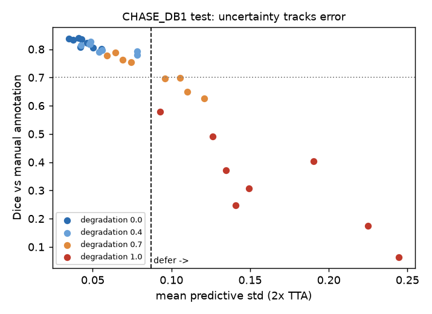
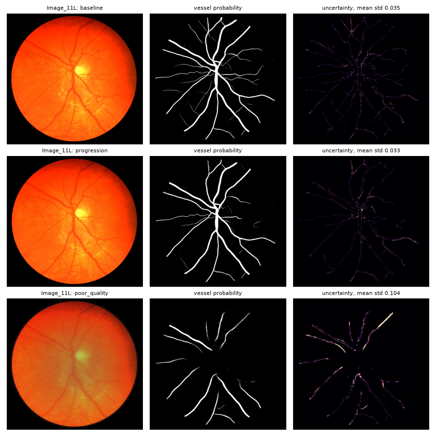

# Teaching an AI to say "I'm not sure": an uncertainty-aware agent for tracking changes in the retina

*Technical report, November 2026. Mohamed Fares Slimani, LIMOSE Laboratory, Universite M'Hamed Bougara de Boumerdes.*

> **Status of this document.** This is an honest write-up of a short exploratory project (one afternoon of work). It is not a peer-reviewed paper, and section 9 explains in detail why it is not yet publishable research. It is written for readers who are curious about AI but not necessarily specialists in medical imaging.

---

## 1. The problem, in plain words

The retina is the only place in the body where doctors can look directly at blood vessels without cutting anything open. A photo of the back of the eye (a *fundus image*) shows a tree of vessels, and diseases such as diabetes and high blood pressure slowly change that tree: small vessels disappear, others narrow.

Deep learning models are now very good at drawing these vessels automatically. This task is called **segmentation**: for every pixel, the model outputs a probability that the pixel belongs to a vessel. My own PhD work compares such models (U-Net, Attention U-Net, U-Net++, FR-UNet).

But a doctor rarely cares about one photo. They care about **change over time**: did the vessels get worse between last year's visit and today's? That sounds simple: segment both photos and compare. Here is the catch:

* A segmentation model **always returns an answer**, even when the photo is bad (blurry, hazy because of a cataract, badly exposed).
* A bad photo makes the model miss vessels. Comparing it with a good photo from last year then looks exactly like **disease progression**.
* Nothing in the pipeline raises a flag. The number looks just as confident as a correct one.

So the risk is not that the model is inaccurate on average. The risk is that it is **wrong without knowing it**, at exactly the moment it matters.

## 2. What we are trying to achieve

The goal is a system that behaves more like a careful junior colleague than a calculator:

1. Measure how the vessels changed between two visits.
2. Check its own work: *how sure am I about each segmentation? Are the two photos aligned properly? Is the change I measured even physically possible?*
3. If something is off, **try again** with more effort, and if it is still off, **hand the case to a human with a clear reason** instead of giving a number.
4. Keep a written record (an *audit trace*) of every step, so a doctor can see why it decided what it decided.

In AI terms, this is a small **agent**: a planner (which can be a large language model such as Claude, or simple rules) that calls **tools** (segment, align, measure, compare) and decides what to do next based on what the tools return.

## 3. Key ideas, explained

**Uncertainty from test-time augmentation (TTA).** If you flip or rotate an image, the vessels do not change, so a confident model should give the same answer each time. We run the model on several flipped and rotated copies, undo the flips, and look at how much the answers disagree. High disagreement means high uncertainty. We measure it as the standard deviation of the predicted probability, averaged over the pixels the model thinks might be vessel ("mean std").

**MC dropout.** Dropout randomly switches off parts of the network during training. If we leave it switched on at prediction time and run the model several times, we get slightly different answers. Their spread is another estimate of uncertainty. We use it as the "try harder" step.

**Registration.** Two photos taken months apart are never perfectly aligned. Before comparing them, we estimate the shift between them (phase correlation) and check the quality of the alignment with a correlation score (NCC, 1.0 means a perfect match).

**Vessel density.** Our simple biomarker: the fraction of the visible retina covered by vessels. Losing small vessels lowers it.

**Repeatability limit.** If you photograph the same healthy eye twice, the measurement still moves a little because of lighting and position. A change smaller than that natural wobble should not be called real. Doctors use the same idea, called *test-retest repeatability*.

**Guard.** A hard rule in the code: the agent is not allowed to output a final "report" while any check has failed. Even if the language model tries to, the guard refuses. This matters because LLMs can be persuasive and occasionally wrong.

## 4. Data

| Dataset | What it is | How we used it |
| --- | --- | --- |
| **CHASE_DB1** | 28 fundus photos (999 x 960 px) of both eyes of 14 children, with vessels drawn by hand by two experts | Main dataset. Split by child: 01-08 for training (16 images), 09-10 for calibration (4), 11-14 for testing (8) |
| DRIVE, STARE, HRF | Other public retinal vessel datasets | Downloaded for a future cross-dataset test, not used yet |
| Synthetic fundus images | Generated by our own code: random branching vessel trees on an orange background | First sanity check of the whole pipeline, with perfect ground truth |

All real datasets were downloaded from a public Kaggle collection (`ipythonx/retinal-vessel-segmentation`). We used the first expert's annotations (`1stHO`). CHASE_DB1 has no field-of-view masks, so we computed them by thresholding the red channel.

Splitting **by child** (not by image) matters: both eyes of the same child look alike, so putting one in training and the other in testing would inflate the results.

**Important: we have no real follow-up visits.** Public datasets contain one photo per eye. So we **simulated** the second visit (section 6). This is the biggest limitation of the whole study.

## 5. The machine

Everything ran on a personal laptop:

| | |
| --- | --- |
| Laptop | ASUS TUF Gaming F15 (FX506HC) |
| CPU | Intel Core i5-11400H, 2.70 GHz |
| RAM | 24 GB |
| GPU | NVIDIA GeForce RTX 3050 Laptop, **4 GB VRAM** |
| OS | Windows 11 Pro |
| Software | Python 3.11, PyTorch 2.5.1 (CUDA 12.1), segmentation-models-pytorch 0.6.0, scikit-image 0.26, NumPy 2.4 |

4 GB of GPU memory is small for deep learning. It is why we trained on 384 x 384 crops instead of full images, used mixed precision, and kept the batch size at 6. Training took about 9 minutes and the full evaluation about 3 minutes.

## 6. What we did, step by step

### Step 1: build the agent on synthetic data
Before touching real images, we built the full pipeline on generated images where the exact answer is known. A small U-Net (about 1.9M parameters) trained in 6 minutes. It reached a Dice score of 0.99, which only shows the synthetic task is easy, not that the model is good. This step let us test the logic: tools, retry, deferral, guard, audit trace. Four automated tests check that logic.

**Thought at this point:** synthetic data proves the plumbing works, but says nothing about real eyes. A reviewer would dismiss it immediately. We needed real data.

### Step 2: train a real segmentation model
We trained a **U-Net with a ResNet-34 encoder pretrained on ImageNet**, the same setup as in my A2I-26 comparative study. We added a dropout layer before the output so MC dropout could work. Training used random crops, rotations, flips and brightness changes, with a loss combining binary cross-entropy and Dice.

Test results on the 8 test images (inside the field of view):

| Dice / F1 | Sensitivity | Specificity | Accuracy |
| --- | --- | --- | --- |
| 0.820 | 0.850 | 0.977 | 0.965 |

This is in the normal range for CHASE_DB1. It is not directly comparable with the numbers in my A2I-26 paper because the split and settings differ.

### Step 3: does uncertainty actually predict errors?
This is the core question. If high uncertainty does not mean "probably wrong", the whole idea collapses.

We took each calibration and test image and created three degraded versions (mild, medium, strong haze plus blur plus noise, imitating a cataract or a bad acquisition). For each version we measured the model's uncertainty and its real accuracy (Dice against the expert drawing).

Then we chose the "too uncertain" threshold **using only the 4 calibration images**, and applied it unchanged to the test images. A segmentation counts as "bad" if its Dice is below 0.70.

### Step 4: simulate follow-up visits
For each of the 8 test eyes we created three fake "second visits":

* **Stable:** same eye, the camera slightly shifted (up to 15 px) and the exposure changed by 5%. The correct answer is "no change".
* **Vessel loss:** we erased about half of the thin vessel segments from the real photo, filling them with the surrounding retina texture. That removes 6 to 10% of the vessel area, a subtle but real change. The correct answer is "decrease detected".
* **Vessel loss + bad photo:** the same, plus strong haze. The correct answer is "defer to a human".

### Step 5: run the agent and look at what went wrong
We ran the agent on all 24 cases. The first run exposed two real problems (section 7.3), which we fixed and then re-ran.

## 7. Results

### 7.1 Uncertainty tracks error

*Each dot is one test segmentation. Left: clean or mildly degraded images, low uncertainty, good Dice. Right of the dashed line: the agent defers.*

| Degradation level | Mean Dice | Mean uncertainty (std) |
| --- | --- | --- |
| none | 0.822 | 0.044 |
| mild (0.4) | 0.804 | 0.057 |
| medium (0.7) | 0.719 | 0.087 |
| strong (1.0) | 0.330 | 0.163 |

| On the 32 test segmentations | |
| --- | --- |
| Rank correlation between uncertainty and error (Spearman) | **0.96** |
| Bad segmentations (Dice < 0.70) caught | **12 / 12** |
| Good segmentations wrongly deferred | **0 / 20** |
| Mean Dice of accepted vs deferred | 0.80 vs 0.44 |

### 7.2 The agent on simulated follow-ups

*One test eye. Top: baseline. Middle: simulated vessel loss, the model still sees the vessel tree clearly and is confident (dark uncertainty map). Bottom: bad photo, vessels vanish from the prediction and the uncertainty map lights up.*

| Scenario | Correct decisions | Notes |
| --- | --- | --- |
| Stable | 7 / 8 | One false alarm: a 3.2% change on eye 13R, just above the 2.9% limit |
| Vessel loss | 8 / 8 | Average error vs the true change: 1.2 percentage points |
| Vessel loss + bad photo | 8 / 8 deferred | 7 caught by uncertainty, 1 by the plausibility check |

### 7.3 What failed, and what we changed

These failures are the most interesting part of the project.

**Failure 1: the first "is this change real?" rule was far too cautious.** Our first rule said a change is real only if the pessimistic and optimistic measurements of the two visits do not overlap. On synthetic data this worked. On real images, uncertainty along vessel borders made these ranges so wide that the agent detected **only 1 of 8** vessel-loss cases. We replaced it with a repeatability limit: we measured how much vessel density wobbles between stable photo pairs of the 4 calibration images (0.8% to 2.0%), multiplied the worst case by 1.5, and got a 2.9% threshold. Detection went from 1/8 to 8/8, at the cost of one false alarm on stable eyes.

**Failure 2: the model was confidently wrong.** On one hazy follow-up (eye 14R), the model stopped seeing most vessels, **but its uncertainty stayed low**: it was not unsure, it was simply blind. The agent reported an **82% vessel loss**. In a clinic, that is the worst possible error: a dramatic, false finding with no warning. This is a known weakness of uncertainty estimation: when an image is far outside what the model has seen, it can be wrong and confident at the same time.

We added a second safety layer that does not depend on the model at all: losing more than 30% of the vessel area between two visits is not physiologically plausible, so such a result is treated as a failed acquisition and deferred. With it, all 8 bad-photo cases were deferred.

**Thought:** the second fix is common sense, but it was added **after** seeing the test result. That is a methodological problem (section 9).

### 7.4 Sanity check on synthetic data
On the generated images, the agent called the stable case "within uncertainty" (0.8% change), measured a 20.1% vessel loss when the true loss was about 19%, and deferred the hazy case after retrying with 8 augmentations and MC dropout.

## 8. What we learned

1. **Uncertainty is useful but not sufficient.** It caught every moderately bad segmentation and correlated strongly with error. It missed the most dangerous case, where the model is blind rather than unsure.
2. **Independent checks matter.** A simple physical plausibility rule caught what uncertainty missed. Safety should not rely on the model judging itself.
3. **Rules that work on synthetic data can fail on real data.** The first change rule looked fine on generated images and collapsed on real ones.
4. **Explicit, logged decisions make errors easy to find.** Both failures were spotted in minutes because every step was recorded.

## 9. Why this is not (yet) publishable research

It is important to be honest about this. A reviewer at a serious venue would reject this work in its current form, for these reasons:

1. **The follow-up visits are simulated.** Erased vessels and synthetic haze are not real disease or real cataracts. We do not know how the agent behaves on real longitudinal pairs. This is the biggest weakness.
2. **The bad photos are simulated too.** Our degradation is smooth and predictable, so the model's uncertainty rises smoothly with it. Real poor-quality images (motion blur, eyelashes, reflections, small pupils) are messier. The 0.96 correlation is probably an upper bound.
3. **The test set is tiny.** 8 eyes from 4 children. With so few cases, one more failure changes the percentages a lot. There are no confidence intervals.
4. **One fix was made after looking at the test results.** The 30% plausibility rule was added because of a test failure. Even if the rule is sensible, tuning a method on the test set makes the final test numbers optimistic. A clean study fixes every rule before touching the test data.
5. **No comparison with alternatives.** We did not compare TTA with deep ensembles, entropy-based uncertainty, or dedicated image-quality models. Without baselines we cannot claim our choice is good, only that it works here.
6. **The method itself is not new.** Using TTA or MC dropout to defer uncertain predictions is well established. A paper needs a new idea or a new finding. The "confidently wrong on very poor images" observation could become one, but only with proper evidence.
7. **Simplifications.** Alignment is translation-only (real eyes rotate and deform), and vessel density is a coarse biomarker (vessel width and tortuosity would be more meaningful).

### What it would take to become a paper
* Use a dataset with **real image-quality labels** (for example EyeQ) instead of synthetic haze.
* Test across datasets (train on CHASE_DB1, test on DRIVE, STARE, HRF) for **real domain shift**.
* Compare several uncertainty methods and an independent image-quality check, with **risk-coverage curves and confidence intervals**.
* Fix every threshold on calibration data **before** running the test.
* Ideally, find **real longitudinal pairs**; otherwise state clearly that follow-ups are simulated.

The core question, *"when does uncertainty fail to warn us, and what catches those cases?"*, is worth studying. This report is the first step, not the result.

## 10. Reproducing everything

Code, figures and result files are in this repository. See the main [README](../README.md) for the commands. The key files:

| File | Content |
| --- | --- |
| `imaging_agent/tools.py` | The tools and the policy thresholds |
| `imaging_agent/agent.py` | The agent, the planners and the guard |
| `imaging_agent/model.py` | Models and uncertainty (TTA + MC dropout) |
| `imaging_agent/data.py` | CHASE_DB1 loading and simulated vessel loss |
| `scripts/train_chase.py` | Model training |
| `scripts/evaluate_chase.py` | Calibration and agent evaluation |
| `runs/chase/results.json` | All numbers reported here |
| `runs/chase/results_band_rule.json` | The first run with the overly cautious change rule (its ground-truth column for stable cases had a bug, fixed afterwards) |
| `runs/chase/trace_*.json` | Example audit traces |
